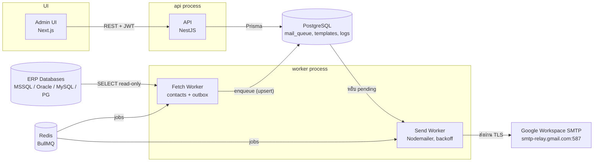

# ERP Mail Relay — System Plan & Design

วันที่: 2026-11-02 · ผู้เขียน: Wei
ฉบับแก้ไขได้ (Claude Docs): https://claude.ai/artifact/XroYR3X7fx78tMFbTgb6Ds

## 1. Overview

ERP Mail Relay คือระบบกลางที่ดึงรายการอีเมลจาก ERP (หลาย database) มากองไว้ใน queue แล้วทยอยส่งผ่าน Google Workspace SMTP โดยใช้ Template ที่ Admin สร้างเอง และเก็บ log ทุกฉบับ

ผู้ใช้งานมีกลุ่มเดียวคือ **Admin** — ไม่มีหน้า public, ไม่มี self-register

**ขอบเขต (In scope)**

1. Admin login + จัดการ Admin user
2. หน้า Sync รายชื่อ (contacts) จาก ERP
3. หน้า Config database — เชื่อม ERP ได้หลาย database พร้อมกัน
4. หน้า Logs การส่ง — ดูสถานะ, ค้นหา, retry
5. หน้า Template — สร้าง/แก้ไข template อีเมลด้วยตัวแปร
6. Worker ดึงเมลจาก ERP → queue → ส่งผ่าน SMTP

**นอกขอบเขต (Out of scope)**

- รับเมลขาเข้า (inbound)
- User ทั่วไปเข้าใช้งาน
- การแก้ไขข้อมูลใน ERP (ระบบอ่านอย่างเดียว ยกเว้น mark-as-sent)

**คำถามที่ต้องตอบก่อนเริ่ม Build**

- [ ] ERP ปล่อยเมลออกมาแบบไหน: ตาราง outbox / API / SMTP / mailbox
- [ ] ERP ใช้ database อะไร (SQL Server, Oracle, MySQL, PostgreSQL)
- [ ] ปริมาณเมลต่อวันโดยประมาณ
- [ ] ใช้ SMTP แบบ App Password หรือ SMTP Relay

## 2. Architecture



รัน 3 process แยกกัน (api, fetch worker, send worker) ใช้ PostgreSQL เดียวกัน; Fetch worker เปิด connection ไป ERP ทีละตัวตาม config, Send worker ไม่แตะ ERP เลย — Redis ใช้จัดตาราง job ของทั้งสอง worker

## 3. Tech Stack

ใช้ stack เดียวกับ PropSpace เพื่อ reuse pattern และ CLAUDE.md ที่มีอยู่

| ส่วน | เทคโนโลยี | เหตุผล |
| --- | --- | --- |
| Backend API | NestJS + TypeScript | มี module/guard/queue pattern พร้อม |
| ORM (ฐานข้อมูลระบบเอง) | Prisma + PostgreSQL | เก็บ config, queue, logs, templates |
| เชื่อม ERP หลาย DB | Knex หรือ TypeORM DataSource (dynamic) | สร้าง connection ตอน runtime จาก config ที่ Admin ใส่ |
| Queue / Worker | BullMQ + Redis | retry, backoff, concurrency, rate limit ในตัว |
| ส่งเมล | Nodemailer | รองรับ SMTP/STARTTLS, attachment |
| Template engine | Handlebars | ตัวแปร `{{customer_name}}`, loop, condition |
| Frontend Admin | Next.js 14 + Tailwind + shadcn/ui | หน้า admin ล้วน ไม่ต้อง SEO |
| Auth | JWT (access + refresh) + bcrypt | Admin เท่านั้น |
| Secret | AES-256-GCM encrypt ใน DB + master key ใน env | รหัสผ่าน DB ของ ERP และ SMTP |
| Deploy | Docker Compose บน VPS (api, worker, web, postgres, redis) | แยก worker ออกจาก api |

DB driver ที่ต้องติดตั้งตาม ERP: `mssql` (SQL Server), `oracledb`, `mysql2`, `pg` — รองรับทั้งหมดแต่โหลดเฉพาะที่ใช้

## 4. Database Schema (PostgreSQL ของระบบเอง)

8 ตารางหลัก + audit — ทุกตารางมี `id (uuid)`, `created_at`, `updated_at`

| ตาราง | หน้าที่ | คอลัมน์สำคัญ |
| --- | --- | --- |
| `admin_users` | ผู้ดูแลระบบ | email (unique), password_hash, name, is_active, last_login_at |
| `erp_connections` | config database ของ ERP แต่ละตัว | name, db_type (mssql/oracle/mysql/pg), host, port, database, username, password_enc, ssl, is_active, last_test_at, last_test_ok |
| `erp_sync_configs` | วิธีดึงข้อมูลจากแต่ละ connection | connection_id (FK), kind (contacts/outbox), query_sql หรือ table+column mapping (json), poll_interval_sec, last_synced_at, last_cursor |
| `contacts` | รายชื่อที่ sync มาจาก ERP | connection_id, erp_ref_id (unique ต่อ connection), name, email, phone, company, raw (json), synced_at |
| `smtp_configs` | SMTP ที่ใช้ส่ง | name, host, port, secure, username, password_enc, from_name, from_email, daily_limit, is_default |
| `mail_templates` | template อีเมล | code (unique เช่น `invoice_due`), name, subject_tpl, body_html_tpl, body_text_tpl, variables (json schema), is_active, version |
| `mail_queue` | เมลที่รอส่ง | connection_id, erp_ref_id (unique ต่อ connection), template_id, smtp_config_id, to_addrs, cc, bcc, variables (json), rendered_subject, rendered_html, attachments (json), status, attempts, next_retry_at, scheduled_at, sent_at, message_id, last_error |
| `mail_logs` | ประวัติทุกเหตุการณ์ของ queue item | queue_id (FK), event (queued/sending/sent/failed/retry/dead/cancelled), detail, smtp_response, created_at |
| `admin_audit_logs` | การกระทำของ Admin | admin_id, action, target, diff (json), ip |

**status ของ `mail_queue`**: `pending` → `sending` → `sent` | `failed` (จะ retry) | `dead` (retry ครบ) | `cancelled`

**Index ที่ต้องมี**: `mail_queue(status, next_retry_at)`, `mail_queue(connection_id, erp_ref_id)` unique, `mail_logs(queue_id, created_at)`, `contacts(connection_id, erp_ref_id)` unique

`password_enc` เก็บเป็น AES-256-GCM ciphertext — API ไม่คืนค่าออกไปที่ frontend เลย ส่งได้แค่ `has_password: true`

## 5. Feature Design

### 5.1 Admin Auth

- Login ด้วย email + password → JWT access (15 นาที) + refresh (7 วัน, httpOnly cookie)
- Admin คนแรกสร้างผ่าน CLI seed (`pnpm db:seed`) ไม่มีหน้า register
- หน้า Admin users: list / add / deactivate / reset password
- Rate limit login 5 ครั้ง/นาที ต่อ IP

### 5.2 Config Database (หลาย ERP)

หน้า `/connections` — ตารางรายการ connection ทั้งหมด พร้อมสถานะ test ล่าสุด

| ฟิลด์ในฟอร์ม | หมายเหตุ |
| --- | --- |
| ชื่อ connection | เช่น `ERP-HQ`, `ERP-Branch2` |
| ประเภท DB | dropdown: SQL Server / Oracle / MySQL / PostgreSQL |
| Host, Port, Database | |
| Username, Password | password เข้ารหัสก่อนเก็บ แสดงเป็น •••• เสมอ |
| SSL | toggle |
| ปุ่ม **Test connection** | รัน `SELECT 1` ผ่าน driver จริง แล้วบันทึก `last_test_ok` |

แต่ละ connection มี **Sync config** ได้ 2 ชนิด: `contacts` (รายชื่อ) และ `outbox` (เมลที่ต้องส่ง) — ใส่เป็น SQL query ที่ Admin เขียนเอง พร้อม column mapping เพราะ schema ของ ERP แต่ละตัวต่างกัน

```sql
-- ตัวอย่าง outbox query (SQL Server)
SELECT DocNo AS erp_ref_id, CustEmail AS to_email,
       CustName AS customer_name, DocNo AS invoice_no,
       DueDate AS due_date, Amount AS amount
FROM EmailOutbox WHERE Status = 'N'
```

ระบบ validate ว่า query เป็น `SELECT` เท่านั้น และมีคอลัมน์ `erp_ref_id` + `to_email` ครบ

### 5.3 Sync รายชื่อจาก ERP

หน้า `/contacts` — เลือก connection → กด **Sync now** หรือรอ cron ตาม `poll_interval_sec`

- Upsert ด้วย `(connection_id, erp_ref_id)` — ไม่สร้างซ้ำ
- แสดงผล sync ล่าสุด: จำนวนเพิ่ม / อัปเดต / error
- ตารางรายชื่อ ค้นหาได้ตาม ชื่อ, email, บริษัท
- ปุ่ม **ส่งทดสอบ** ต่อ 1 รายชื่อ เลือก template แล้วส่งทันที

### 5.4 Template อีเมล

หน้า `/templates` — list + editor

- ฟิลด์: code, ชื่อ, subject, body HTML (editor + raw HTML toggle), body text
- ตัวแปรแบบ Handlebars เช่น `{{customer_name}}`, `{{invoice_no}}`, `{{amount}}` — ชื่อตัวแปรต้องตรงกับ column alias ใน outbox query
- Panel ขวา: **Preview** ด้วยข้อมูลตัวอย่าง + ปุ่ม **ส่งทดสอบ** ไปที่อีเมล Admin
- เก็บ version ทุกครั้งที่ save (เพื่อดูย้อนหลังว่าเมลที่ส่งไปใช้ template เวอร์ชันไหน)
- Template ผูกกับ outbox sync config: 1 sync config → 1 template (หรือเลือกจาก column `template_code` ใน query ถ้า ERP ระบุมา)

### 5.5 Logs การส่ง

หน้า `/logs` — ตาราง `mail_queue` join `mail_logs`

- Filter: สถานะ, connection, template, ช่วงวันที่, ค้นหาด้วย email / erp_ref_id
- คอลัมน์: เวลา, ผู้รับ, subject, template, สถานะ (badge), attempts, message_id
- คลิกแถว → drawer แสดง timeline เหตุการณ์ทั้งหมด + เมลที่ render แล้ว + SMTP response
- Action: **Retry** (failed/dead → pending), **Cancel** (pending → cancelled)
- Dashboard บนสุด: ส่งสำเร็จวันนี้ / ล้มเหลว / รอส่ง / ใช้ไป x จาก daily_limit
- เก็บ log 90 วัน แล้ว archive (cron รายวัน)

## 6. Worker: Fetch และ Send

แยกเป็น 2 job ใน BullMQ รันคนละ process จาก API เพื่อให้ตายได้ทีละตัว

**Fetch job** (ทุก `poll_interval_sec` ต่อ connection)

1. เปิด connection ไปยัง ERP ด้วย config ที่ decrypt แล้ว
2. รัน outbox query ดึงแถวที่ยังไม่เคยดึง (`last_cursor` หรือ `Status = 'N'`)
3. ต่อแถว: upsert `mail_queue` ด้วย `(connection_id, erp_ref_id)` — ถ้ามีแล้วข้าม
4. Render template ทันทีตอน enqueue (เก็บ `rendered_subject`, `rendered_html`) เพื่อให้ log ตรงกับสิ่งที่ส่งจริง
5. ถ้ามี attachment ให้ copy ไฟล์มาเก็บที่ `storage/attachments/<queue_id>/` ตั้งแต่ตอนนี้
6. เขียน `mail_logs` event `queued`
7. ถ้า ERP ต้องการ mark-as-fetched ให้ UPDATE กลับ (optional, ตั้งใน sync config)

**Send job** (BullMQ worker, concurrency 2, rate limit 1 ฉบับ/วินาที)

1. หยิบ `pending` ที่ `next_retry_at <= now` เรียงตาม `scheduled_at`
2. Mark `sending` + เขียน log
3. ส่งด้วย Nodemailer ผ่าน `smtp_configs` ที่ผูกไว้
4. สำเร็จ → `sent`, เก็บ `message_id`, log `sent`
5. ล้มเหลว → `attempts + 1`, `next_retry_at` = backoff (1m, 5m, 30m, 2h, 8h), log `failed`; ครบ 5 ครั้ง → `dead` + แจ้งเตือน Admin ทางอีเมล
6. เช็ก `daily_limit` ก่อนส่งทุกครั้ง — ถ้าใกล้เต็มให้หยุดแล้วรอวันถัดไป

**กรณีพิเศษ**

- Worker ตายกลางทาง: item ค้างที่ `sending` เกิน 10 นาที → cron กู้กลับเป็น `pending`
- SMTP ตอบ 5xx (เช่น address ไม่ถูกต้อง) → `dead` ทันที ไม่ retry
- SMTP ตอบ 4xx / timeout → retry ตามปกติ

## 7. Security และ PDPA

- รหัสผ่าน DB ของ ERP และ SMTP เข้ารหัส AES-256-GCM ด้วย `MASTER_KEY` จาก env (ไม่อยู่ใน DB, ไม่ commit) — หมุน key ได้ผ่าน CLI `rotate-key`
- SQL ที่ Admin ใส่ต้องผ่าน allowlist: `SELECT` เท่านั้น, ห้าม `;`, ห้าม `INTO`, `EXEC`, `xp_` — รันด้วย DB user ที่เป็น read-only ฝั่ง ERP
- Connection ไป ERP ใช้ timeout 10 วินาที และ max 2 connection ต่อ ERP เพื่อไม่กระทบ ERP
- API ทุกเส้นทางอยู่หลัง JWT guard ยกเว้น `/auth/login` และ `/health`
- Audit log การกระทำของ Admin: สร้าง/แก้ connection, template, retry, cancel (ตาราง `admin_audit_logs`)
- PDPA: `contacts` และ `mail_queue` มีข้อมูลส่วนบุคคล — เก็บ rendered email 90 วันแล้วลบ, มี endpoint ลบข้อมูลตาม email เมื่อได้รับคำขอ, ไม่ log เนื้อหาเมลลง stdout
- Attachment เก็บนอก web root, serve ผ่าน API ที่ตรวจสิทธิ์เท่านั้น
- HTTPS บังคับ (Nginx + Let's Encrypt), CORS จำกัดเฉพาะโดเมน admin

## 8. Build Plan (Handoff สำหรับ Claude Code)

6 milestone เรียงตาม dependency — แต่ละ milestone จบด้วย QC gate (test ผ่าน + lint ผ่าน + review) ก่อน commit และก่อนเริ่มตัวถัดไป รายละเอียด task ของ milestone ปัจจุบันอยู่ใน `PLAN.md`

**M1 — Foundation** (API + DB + Auth)

- Monorepo: `apps/api` (NestJS), `apps/worker`, `apps/web` (Next.js), `packages/shared`
- Prisma schema ตาม section 4 + migration แรก
- Admin auth: login, refresh, guard, seed CLI
- Crypto service (encrypt/decrypt) + unit test
- Docker Compose: postgres, redis, api, worker, web
- QC gate: `pnpm test` + `pnpm lint` ผ่าน, login ได้จาก web

**M2 — ERP Connections**

- CRUD `erp_connections` + Test connection endpoint (mssql, pg, mysql, oracle)
- Dynamic DataSource factory + connection pool ต่อ connection
- SQL validator (SELECT-only allowlist) + unit test
- หน้า `/connections` + ฟอร์ม + ปุ่ม Test
- QC gate: เชื่อม ERP จริงอย่างน้อย 1 ตัวแล้ว Test ผ่าน

**M3 — Sync รายชื่อ**

- CRUD `erp_sync_configs` (kind=contacts) + column mapping
- Fetch job สำหรับ contacts + upsert
- หน้า `/contacts` + Sync now + ผลลัพธ์
- QC gate: sync รายชื่อจริงจาก ERP ได้ ไม่สร้างซ้ำเมื่อรันซ้ำ

**M4 — Templates + SMTP**

- CRUD `smtp_configs` + ปุ่ม Test SMTP
- CRUD `mail_templates` + versioning + Handlebars render service
- หน้า `/templates` editor + preview + ส่งทดสอบ
- QC gate: ส่งเมลทดสอบผ่าน Google Workspace ถึงกล่องจริง

**M5 — Mail Queue + Worker**

- Sync config kind=outbox + Fetch job → `mail_queue`
- Send job: BullMQ worker, retry/backoff, daily limit, recovery cron
- `mail_logs` ทุก event
- QC gate: integration test end-to-end: ERP outbox → queue → sent, ทดสอบ retry โดยปิด SMTP ชั่วคราว

**M6 — Logs + Hardening**

- หน้า `/logs` filter + drawer + Retry/Cancel
- Dashboard ตัวเลขบนสุด
- Audit log, archive cron 90 วัน, PDPA delete endpoint
- Nginx + HTTPS + README deploy
- QC gate: security review ตาม section 7, load test ส่ง 1,000 ฉบับ
